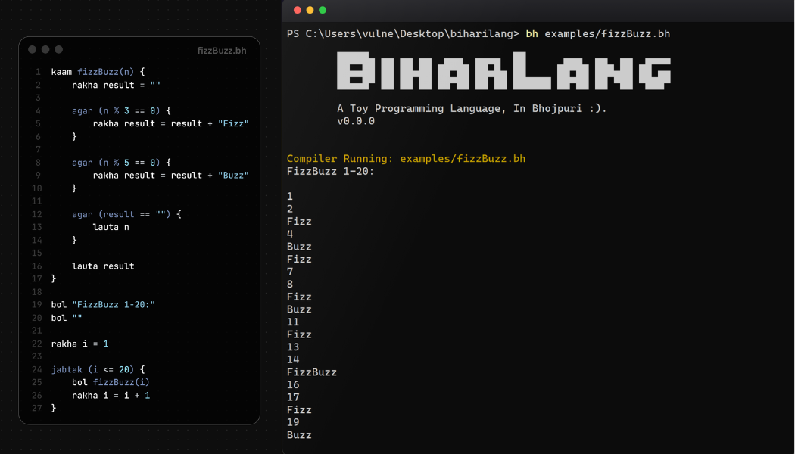
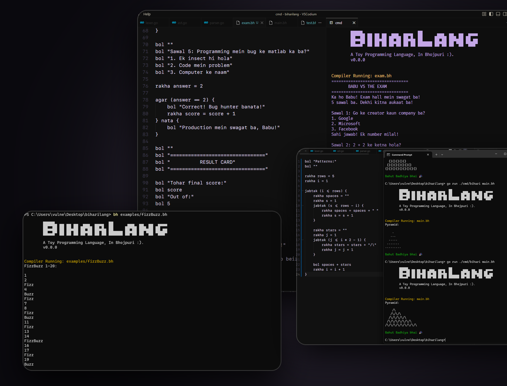

# BiharLang

<p align="center">
    
    
</p>

**BiharLang is a toy programming language written in Go.**

BiharLang is a dynamically typed, interpreted programming language where all keywords are derived from the Bhojpuri language.

It is built entirely from scratch in Go With an interactive REPL Mode As Well.
This project was built as an educational exercise in language design, compiler theory, and interpreter architecture.

**Version:** 0.1.0

Made with ❤️ For Fun 
Thanks to my fellow friends from Bihar who helped me with the keywords 😂

---

## Table of Contents

- [Key Features](#key-features)
- [Project Structure](#project-structure)
- [Installation](#installation)
- [Usage](#usage)
- [Language Reference](#language-reference)
- [Examples](#examples)
- [Architecture](#architecture)
- [Roadmap](#roadmap)
- [License](#license)

---

## Key Features

- **Hand-written Lexer** — Tokenizes raw source code into a stream of typed tokens.
- **Pratt Parser** — Builds an Abstract Syntax Tree using top-down operator precedence parsing.
- **Tree-walking Evaluator** — Executes the AST directly with a scoped environment supporting closures.
- **Interactive REPL** — Read-Eval-Print Loop for instant code experimentation.
- **File Execution** — Run `.bh` script files directly from the command line.
- **Custom Error Messages** — Runtime and syntax errors with personality.
- **First-class Functions** — Function definitions, calls, recursion, and closures.

---

## Project Structure

```text
biharlang/
├── cmd/
│   └── bihari/
│       └── main.go                 # CLI entry point (REPL and file runner)
├── lexer/
│   ├── lexer.go                    # Tokenizer implementation
│   └── lexer_test.go               # Lexer unit tests
├── parser/
│   ├── parser.go                   # Pratt parser implementation
│   └── parser_test.go              # Parser unit tests
├── evaluator/
│   ├── evaluator.go                # Tree-walking evaluator
│   ├── evaluator_test.go           # Evaluator unit tests
│   └── environment.go              # Scoped variable environment (closures)
├── ast/
│   └── ast.go                      # Abstract Syntax Tree node definitions
├── object/
│   └── object.go                   # Runtime value types
├── token/
│   └── token.go                    # Token type definitions and keyword lookup
├── repl/
│   └── repl.go                     # Interactive REPL implementation
├── go.mod                          # Go module definition
├── main.bh                         # Example BiharLang script
├── README.md
└── LICENSE
```

---

## Installation

### Prerequisites

- **Go 1.21** or higher installed and configured in your system PATH.

### From Installer
Download the bh.exe file from the [Releases](https://github.com/CoderZ90/BiharLang/releases/tag/v0.0.1) section.

    1. After Downloading the bh.exe file from the Assets section.
    2. Move bh.exe to a folder on your system (e.g., C:\bihari).
    3. Add that folder to your system's Environment Variables (PATH).
    4. Open a new terminal and you are ready to code!

### Manual Setup

```bash
# Clone the repository
git clone https://github.com/<your-username>/biharlang.git
cd biharlang

# Verify the project builds
go build ./cmd/bihari
```

### Build a Standalone Binary

```bash
# Windows
go build -o bh.exe ./cmd/bihari

# Linux / macOS
go build -o bh ./cmd/bihari
```

Move the binary to a directory in your system PATH to use the `bh` command globally.

---

## Usage

### Run a Script File

```bash
go run ./cmd/bihari main.bh
```

Or using the compiled binary:
```bash
    bh file.bh # runs a BiharLang file 
    bh compile main.bh # compile and run a BiharLang file
    bh repl # repl mode
    bh help # shows this help message
```

```bash


        █████▄ ▄▄ ▄▄ ▄▄  ▄▄▄  ▄▄▄▄  ██      ▄▄▄  ▄▄  ▄▄  ▄▄▄▄
        ██▄▄██ ██ ██▄██ ██▀██ ██▄█▄ ██     ██▀██ ███▄██ ██ ▄▄
        ██▄▄█▀ ██ ██ ██ ██▀██ ██ ██ ██████ ██▀██ ██ ▀██ ▀███▀

        A Toy Programming Language, In Bhojpuri :).
        v0.0.0


Usage:
  bh <file.bh>          Run a Bihari file
  bh compile <file.bh>  Compile and run a Bihari file
  bh run <file.bh>      Same as compile
  bh repl               Start interactive REPL
  bh help               Show this help message
```

### Start the Interactive REPL

```bash
go run ./cmd/bihari
```

Or using the compiled binary:

```bash
bh
bh repl
```

### Run Tests

```bash
go test ./... -v
```

---

## Language Reference

### Keywords

| Bihari Keyword | English Equivalent | Description |
|---|---|---|
| `rakha` | `let` / `var` | Declare and assign a variable |
| `bol` | `print` | Print output to the console |
| `agar` | `if` | Conditional branch |
| `nata` | `else` | Alternative branch |
| `jabtak` | `while` | Loop construct |
| `kaam` | `function` | Define a function |
| `lauta` | `return` | Return a value from a function |
| `sach` | `true` | Boolean literal for true |
| `jhoot` | `false` | Boolean literal for false |
| `kuchnahi` | `null` | Null value |

### Operators

| Operator | Description | Example |
|---|---|---|
| `+` | Addition / String concatenation | `10 + 5`, `"a" + "b"` |
| `-` | Subtraction | `10 - 5` |
| `*` | Multiplication | `10 * 5` |
| `/` | Integer division | `10 / 5` |
| `==` | Equality | `x == 10` |
| `!=` | Inequality | `x != 10` |
| `<` | Less than | `x < 10` |
| `>` | Greater than | `x > 10` |
| `<=` | Less than or equal | `x <= 10` |
| `>=` | Greater than or equal | `x >= 10` |
| `=` | Assignment | `rakha x = 5` |

### Delimiters

| Symbol | Usage |
|---|---|
| `( )` | Grouping, function parameters, conditionals |
| `{ }` | Code blocks |
| `,` | Argument and parameter separator |

### Data Types

| Type | Example |
|---|---|
| Integer | `42` |
| String | `"hello"` |
| Boolean | `sach`, `jhoot` |
| Null | `kuchnahi` |
| Function | `kaam add(a, b) { lauta a + b }` |
| Error | Runtime error object |

---

## Examples

### 1. Variables and Printing

```text
rakha naam = "Babu"
rakha umar = 25

bol "Ka ho " + naam + "!"
bol umar
```

**Output:**

```text
Ka ho Babu!
25
```

---

### 2. Conditionals

```text
rakha paisa = 500

agar (paisa > 100) {
    bol "Ameer ba"
} nata {
    bol "Garib ba"
}
```

**Output:**

```text
Ameer ba
```

---

### 3. Functions and Recursion

```text
kaam factorial(n) {
    agar (n <= 1) {
        lauta 1
    }
    lauta n * factorial(n - 1)
}

bol factorial(5)
```

**Output:**

```text
120
```

---

### 4. While Loop

```text
rakha x = 1

jabtak (x <= 5) {
    bol x
    rakha x = x + 1
}
```

**Output:**

```text
1
2
3
4
5
```

---

### 5. Closures

```text
rakha x = 10

kaam getX() {
    lauta x
}

bol getX()
```

**Output:**

```text
10
```

---

### 6. Star Pattern

```text
rakha i = 1

jabtak (i <= 5) {
    rakha stars = ""
    rakha j = 1

    jabtak (j <= i) {
        rakha stars = stars + "* "
        rakha j = j + 1
    }

    bol stars
    rakha i = i + 1
}
```

**Output:**

```text
*
* *
* * *
* * * *
* * * * *
```

---

## Architecture

BiharLang follows a three-stage interpreter pipeline:

```text
Source Code  -->  Lexer  -->  Parser  -->  AST  -->  Evaluator  -->  Runtime Values
   (.bh)         (Tokens)    (Tree)             (Execution)         (Objects)
```

### Stage 1: Lexer

**File:** `lexer/lexer.go`

The lexer reads raw source code character by character and produces a stream of tokens. It handles single-character operators, two-character operators (`==`, `!=`, `<=`, `>=`), identifiers, keywords, integer literals, and string literals.

### Stage 2: Parser

**File:** `parser/parser.go`

The parser consumes the token stream and builds an Abstract Syntax Tree. It uses **Pratt parsing** (top-down operator precedence) to correctly handle operator precedence without a grammar file.

**Precedence levels (lowest to highest):**

| Level | Operators |
|---|---|
| LOWEST | -- |
| EQUALS | `==`, `!=` |
| LESSGREATER | `<`, `>`, `<=`, `>=` |
| SUM | `+`, `-` |
| PRODUCT | `*`, `/` |
| CALL | Function calls `()` |

### Stage 3: Evaluator

**File:** `evaluator/evaluator.go`

The evaluator walks the AST recursively and computes runtime values. It uses an Environment (scoped map) for variable storage, supporting nested scopes and closures.

**File:** `evaluator/environment.go`

The environment implements lexical scoping. Each function call creates an enclosed environment that references its parent scope, enabling closures.

### Runtime Objects

**File:** `object/object.go`

All runtime values implement the `Object` interface:

```go
type Object interface {
    Type() ObjectType
    Inspect() string
}
```

**Object types:** Integer, String, Boolean, Null, Function, ReturnValue, Error.

---

## Roadmap

### Planned Features (Post-MVP)

| Feature | Keyword / Syntax | Status |
|---|---|---|
| User Input | `input()` | Planned |
| Arrays | `[1, 2, 3]` | Planned |
| Hash Maps | `{"key": "value"}` | Planned |
| Logical Operators | `aur`, `ya`, `ulta` | Planned |
| Comments | `//`, `/* */` | Planned |
| Break / Continue | `bas`, `aage` | Planned |
| Built-in Functions | `len()`, `push()`, `typeOf()` | Planned |
| File I/O | Read/write text files | Planned |
| String Methods | `.length()`, `.upper()` | Planned |
| Windows Installer | Inno Setup / NSIS | Planned |

---

## License

This project is licensed under the **MIT License**. See the [LICENSE](LICENSE) file for details.

## Inspiration
> AI was used very little in building this project ❤️
>
> I’ve always wanted to understand how programming languages are made, so I decided to build my own toy programming language from scratch.
>
> Inspired by [Bhai Lang](https://bhailang.js.org/) — huge respect to the developers who built it. It was one of the projects that inspired me to make something fun and weird of my own.
>
> I also learned a lot from [The Super Tiny Compiler](https://github.com/hazbo/the-super-tiny-compiler), a tiny compiler written in Go. I started by reading through it, and it helped me understand many of the concepts behind how languages work.
